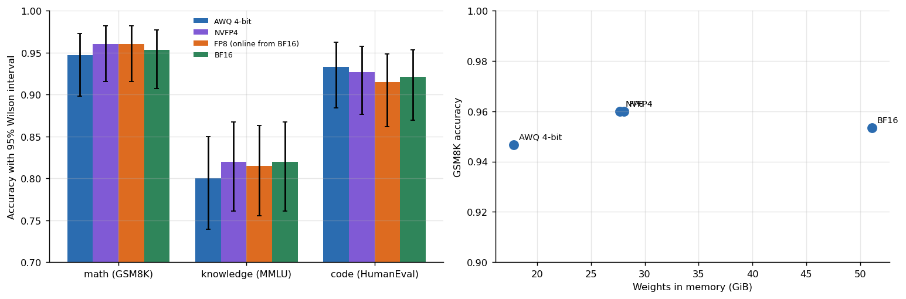
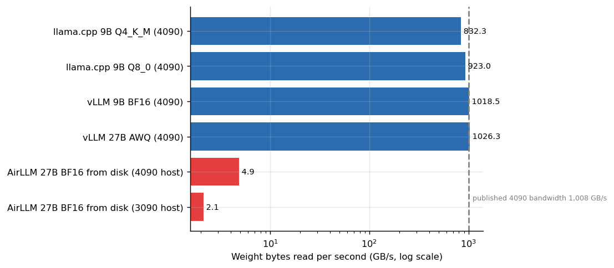
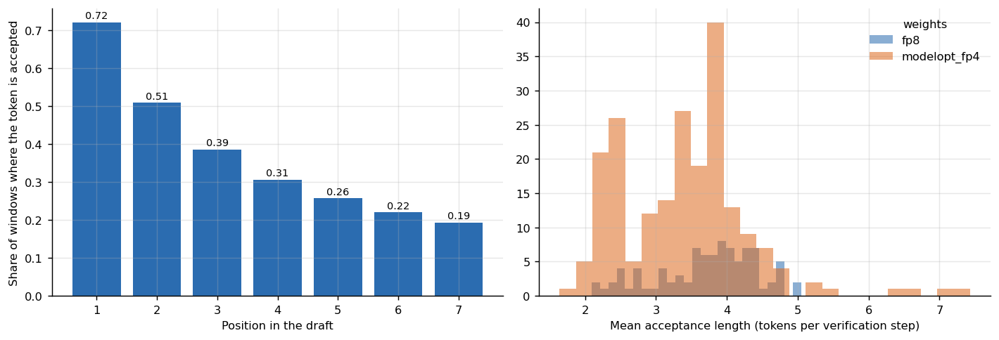

# Quantization and offload lab

**What does it cost, in accuracy and in speed, to run a 27B model in 4 bits, in FP8, in NVFP4, or not on the GPU at all?** A controlled ladder (same server, same limits, same 538 items per build), a measurement of speculative decoding, and the arithmetic that explains every speed in the study: decode is a memory-bandwidth problem.



## Why this matters

Everyone who rents or buys a GPU for language models faces the same choice: a smaller number format fits on a cheaper card, and the open question is what it costs. Public claims about this are mostly anecdotes. Here each build answered the same items, so the comparison is *paired*: for every question we know whether two builds agreed, and a McNemar test says whether the disagreements could be chance.

## Headline results

| Finding | Evidence |
|---|---|
| **No precision is detectably worse** on math, knowledge, code or JSON formatting | Largest paired difference has p = 0.48 across 12 tests (`results/tables/paired_tests_vs_bf16.md`); GSM8K 0.947 (AWQ) against 0.953 (BF16), n = 150 |
| **AWQ is the only build that is really small** | AWQ 17.8 GiB, NVFP4 27.7 GiB, FP8 28.1 GiB, BF16 51.1 GiB. This NVFP4 checkpoint is **no smaller than FP8** (the reason was not inspected), so it buys no memory |
| Smaller weights leave more KV cache | 654,396 cached tokens with AWQ against 318,042 with BF16 on the same card |
| Every route that stays on the card reads weights at about a terabyte per second | 832 to 1,026 GB/s implied (speed x bytes per token) |
| Offloading a model that fits when quantized is the wrong order of operations | AirLLM streamed 0.089 tokens/s on the fastest host; reading weights at 4.9 GB/s. A 164-problem coding evaluation would take about 6.4 days |



The second figure is the most useful idea in the repository. Multiply a build's single-stream speed by the bytes it reads per token and you get its memory bandwidth, whatever the engine: vLLM, llama.cpp, a 9B or a 27B model all land near the card's published figure. The offloaded model lands at about half a percent of it, which is why quantizing to fit beats streaming from disk by two orders of magnitude.

## Speculative decoding

A small drafter proposes up to 7 tokens and the large model verifies them in one pass. Across 384 logged windows the mean acceptance length was 3.60 tokens per step; the first drafted token is accepted 72% of the time and the seventh only 19%, so each extra drafted token adds less than the one before. Speculation raises single-user speed several times on some cards and *lowers* aggregate throughput under load on others; that interaction is measured in the serving repository.



## Repository map

```
src/quantlab/   intel.py (capability harness), llm_bench.py (load generator), run_ladder.sh (the whole ladder session)
analysis/       ladder.py, speculation.py, offload.py  (+ benchkit.py: Wilson, McNemar, bandwidth identity)
data/           ladder, per-item results, speculative windows, AirLLM and llama.cpp runs
results/        figures and every table as CSV and Markdown
tests/          conclusions that must keep following from the data
```

## Reproduce

```bash
make setup && make all
```

To rerun the ladder itself you need a GPU with enough memory for the builds you want and the model files (they are downloaded by `run_ladder.sh`; none are redistributed here). The benchmark datasets are the public GSM8K, MMLU and HumanEval-style tasks fetched at run time.

## Limits

Each build was run once on one RTX PRO 6000; the AWQ build was also run on an RTX 3090 and agreed within noise. A paired test on a few hundred items detects differences of several points and says nothing about half a point, so the supported claim is "not detectably worse", not "equal". Accuracy on the L40S (where NVFP4 runs through a software kernel) was not measured. The behavior of the models on boundary-testing prompts was evaluated in the study but **no prompts or outputs are published**.

## Articles that use this repository

- [The quantization ladder for a 27B model](https://www.kaggle.com/code/lucasrangelss/the-quantization-ladder-for-a-27b-model)
- [How much speculative decoding really speeds up](https://www.kaggle.com/code/lucasrangelss/how-much-speculative-decoding-really-speeds-up)
- [A 27B model on a 24 GB card in three ways](https://www.kaggle.com/code/lucasrangelss/a-27b-model-on-a-24-gb-card-in-three-ways)
- [Measuring refusal behavior in 27B builds](https://www.kaggle.com/code/lucasrangelss/measuring-refusal-behavior-in-27b-builds) (aggregates only)
- Related repositories: [llm-serving-engines-bench](https://github.com/LucasRangelSSouza/llm-serving-engines-bench), [vast-gpu-benchmark-harness](https://github.com/LucasRangelSSouza/vast-gpu-benchmark-harness)

Licence: MIT for this code; tools and weights keep their own, see `LICENSE_NOTES.md`.
